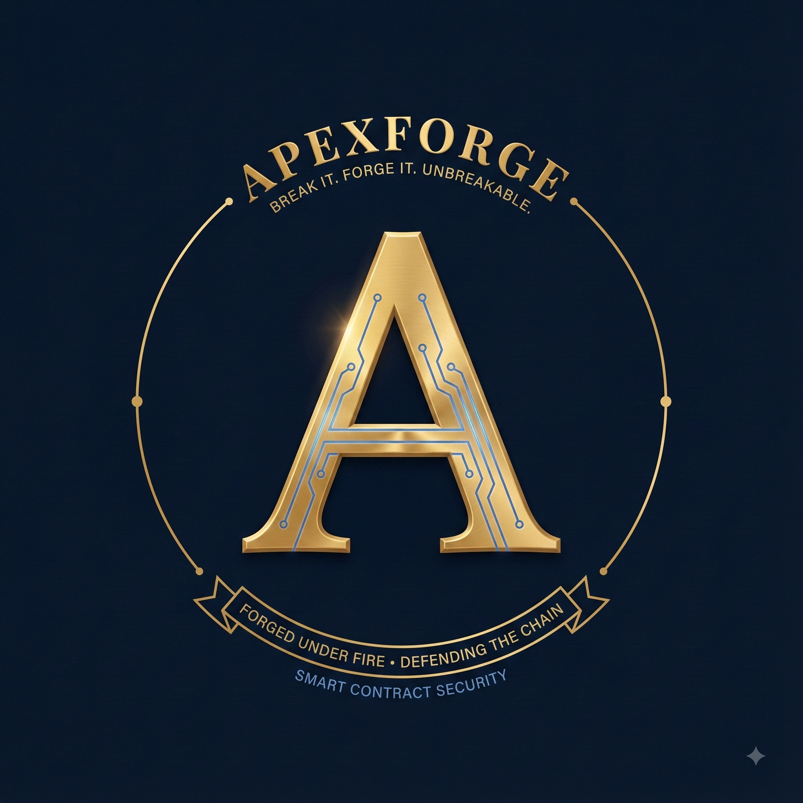
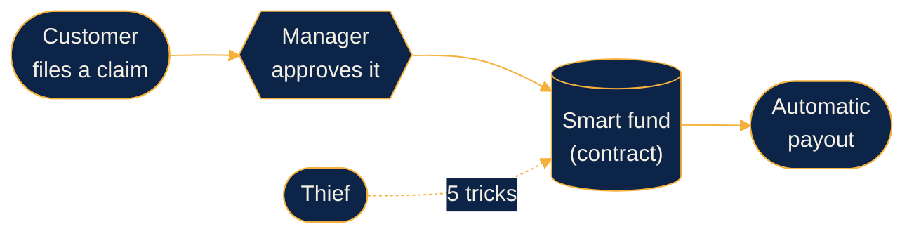
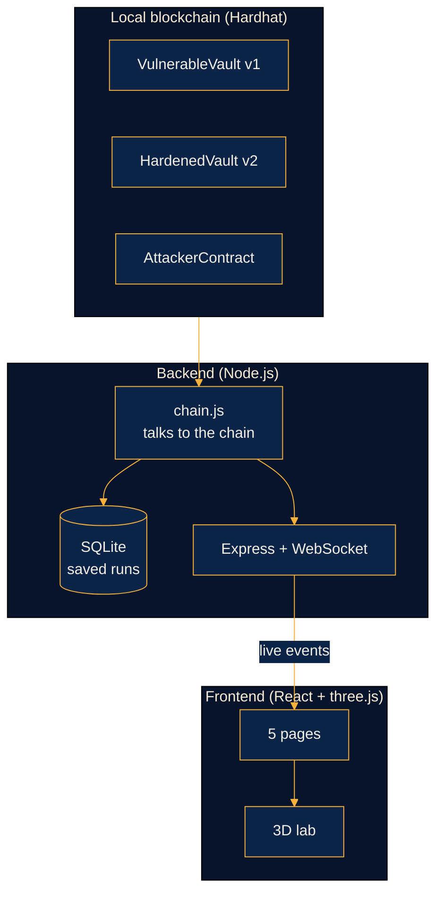

<div align="center">



<br/>



<br/>

###  A blockchain-based insurance claiming and smart fund disbursement system, tested by live attacks

<br/>

[](https://YOUR-VERCEL-LINK)
[](#run)
[](#what)


<br/>

<a href="#what"> <b>What is it</b></a> &nbsp;•&nbsp;
<a href="#how"> <b>How it works</b></a> &nbsp;•&nbsp;
<a href="#attacks"> <b>5 Attack tricks</b></a> &nbsp;•&nbsp;
<a href="#stack"> <b>Tech stack</b></a> &nbsp;•&nbsp;
<a href="#shots"> <b>Screenshots</b></a> &nbsp;•&nbsp;
<a href="#run"> <b>Run it</b></a>

</div>


<a id="what"></a>

##  What is ApexForge?

Imagine an insurance company whose **payout fund is run by a smart contract** instead of clerks. A customer files a claim, a manager approves it, and the contract pays out automatically. That is fast and fair, **but only if the contract has no hidden weak spots.**

ApexForge builds **two copies of the same fund** and attacks both, live:

| |  Old System |  Secured System |
|---|---|---|
| **Contract** | `VulnerableVault` (v1) | `HardenedVault` (v2) |
| **Locks** | Weak, easy to fool | Rebuilt with 5 safety fixes |
| **Against 5 attacks** | Gets robbed | Blocks every one |
| **Safety score** | **0%** | **100%** |

You watch it happen in a **3D lab**: thieves fly in, notes fly out, shields flash, and every move is read from real blockchain events.

>  **Amounts are shown in rupees** (₹1,00,000 per test coin) to keep things simple. The chain underneath is a local practice network, so **no real money ever moves.**


<a id="how"></a>

##  How it works



**The whole system, end to end:**




<a id="attacks"></a>

##  The 5 attack tricks

Each trick has a real-life version you already know.

| # | Plain name | Technical name | Real-life version | Old System | Secured System |
|:-:|---|---|---|:-:|:-:|
| 1 | **Repeat-Withdrawal Trick** | Reentrancy | Asking the cashier for the same cash again before the ledger is updated |  Robbed |  Blocked |
| 2 | **Fake-Approval Trick** | Broken access control | Stamping APPROVED on your own form |  Robbed |  Blocked |
| 3 | **Photocopied-Cheque Trick** | Signature replay | Photocopying a cheque that never expires |  Robbed |  Blocked |
| 4 | **Same-Accident Trick** | Double claim | Claiming insurance twice for one accident |  Robbed |  Blocked |
| 5 | **Fake-Identity Trick** | `tx.origin` phishing | Using the owner's identity through a middleman |  Robbed |  Blocked |

<details>
<summary> <b>Click to see how the Secured System stops each one</b></summary>

<br/>

1. **Repeat-Withdrawal** → updates its records first, then pays, and locks the counter while serving someone (a reentrancy guard).
2. **Fake-Approval** → only accepts approvals from the real verifier (the manager).
3. **Photocopied-Cheque** → every payout slip has a one-time serial number (a nonce) and an expiry date.
4. **Same-Accident** → records every incident number, so one accident means one payout.
5. **Fake-Identity** → checks who is directly asking (`msg.sender`), not who started the chain of actions (`tx.origin`).

</details>

>  **Real life:** in 2016, a blockchain fund called *The DAO* lost tens of millions of dollars to trick number 1.


<a id="features"></a>

##  Features

-  **3D live lab** with glowing vaults, a force-field shield, a thief drone, flying banknotes, sparks and shockwaves
-  **Real-time** behaviour: every effect is triggered by a real blockchain event over WebSocket
-  **5 pages:** Start Here, Live Lab, The 5 Tricks, Replay, Claims Ledger
-  **Replay Theatre:** any saved run, frame by frame
-  **PDF claim receipts and statements** from the Claims Ledger
-  **Plain-English explanations** for every blockchain word
-  **Full Showdown button:** Old vs Secured, all 5 tricks, one click

<details>
<summary> <b>Click for the blockchain words in plain English</b></summary>

<br/>

| Word | What it really means |
|---|---|
| **Blockchain** | A shared notebook everyone can read and nobody can erase |
| **Smart contract** | A self-running rulebook that pays automatically when its rules are met |
| **Transaction** | One recorded action, like filing a claim or sending a payout |
| **Block** | One page of the notebook, holding a batch of transactions |
| **Wallet** | An account number plus a secret key that proves it is you |
| **Signature** | A digital stamp that proves who approved something |
| **Test coins (ETH)** | Practice money of the practice network, shown here as rupees |

</details>


<a id="stack"></a>

##  Tech stack

| Layer | Technology |
|---|---|
|  **Smart contracts** | Solidity, Hardhat (12 tests) |
|  **Backend** | Node.js, Express, WebSocket, SQLite |
|  **Frontend** | React, Vite, three.js (bloom, glass, shaders) |
|  **Design** | Playfair Display + Manrope, navy and gold theme |
|  **Hosting** | GitHub + Vercel (frontend) |


<a id="shots"></a>

##  Screenshots

<div align="center">

| Start Here | Live Lab |
|:-:|:-:|
|  |  |

| Replay | Claims Ledger |
|:-:|:-:|
|  |  |

</div>


<a id="run"></a>

##  Run it locally

**You need:** [Node.js](https://nodejs.org) and [Git](https://git-scm.com).

###  The quick way (Windows)

```powershell
git clone https://github.com/YOURNAME/apexforge.git
cd apexforge
.\start-demo.ps1
```

Then open **http://localhost:5173**

###  The manual way

Install packages once in each folder (`chain`, `backend`, `frontend`) with `npm install`. Then use 3 terminals:

| Terminal | Folder | Commands |
|:-:|---|---|
| 1 | `chain` | `npx hardhat node` |
| 2 | `backend` | `node deploy.js` then `node server.js` |
| 3 | `frontend` | `npm run dev` |

###  Run the tests

```powershell
cd chain
npx hardhat test
```

You should see **12 passing**.

<details>
<summary> <b>Click for the demo checklist</b></summary>

<br/>

| Check | Expected |
|---|---|
| Old System, run all 5 tricks | 5 broken, safety 0% |
| Secured System, run all 5 tricks | 5 blocked, safety 100% |
| Replay a saved run | Slider, play and step all work |
| Reset demo | Back to ₹10,00,000, history cleared |

</details>


##  Project structure

```
apexforge/
├── chain/              Smart contracts, tests, Hardhat
├── backend/            deploy.js, chain.js, Express + WebSocket, SQLite
├── frontend/           React app, 3D scene, pages
│   ├── public/         logo.png
│   └── src/            Scene3D.jsx, Hero3D.jsx, pages/
├── assets/             README banner, divider and icons
├── docs/               Screenshots and notes
├── start-demo.ps1      Starts everything in one go
├── DEMO_SCRIPT.md      What to say during the demo
└── VIVA_QA.md          Questions and answers for the viva
```


<div align="center">

###  Built for the Sem VII Blockchain Technology mini project

**Manali** · B.Tech Computer Science and Technology
Usha Mehta Institute of Technology, SNDT University, Mumbai

<br/>

 **If you like this project, give it a star!** 

<sub>Break it. Forge it. Make it unbreakable.</sub>

</div>